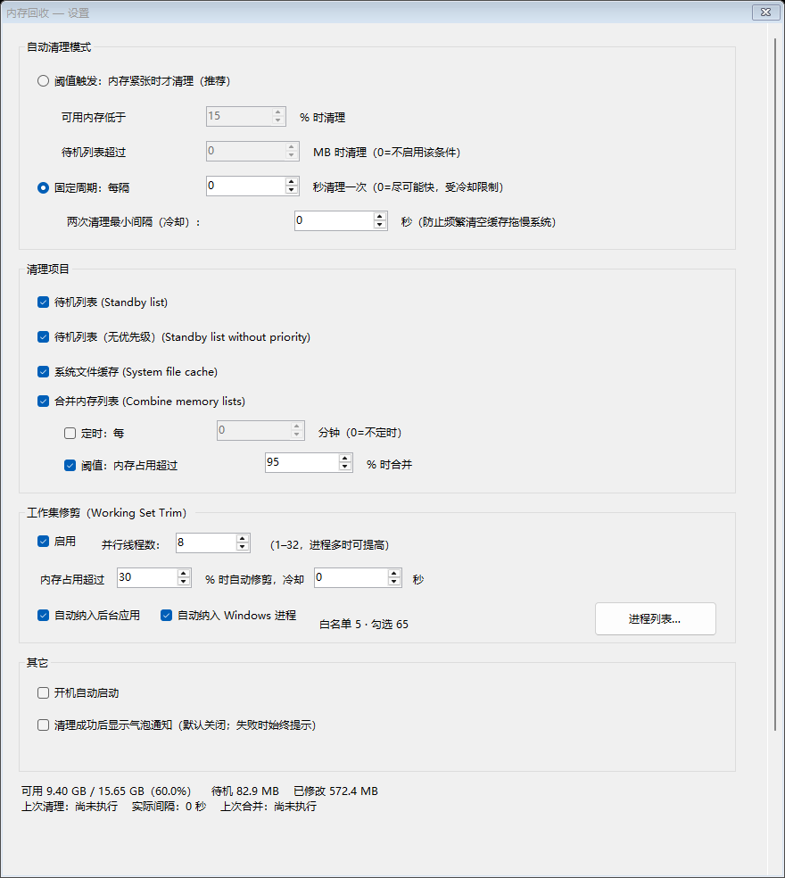
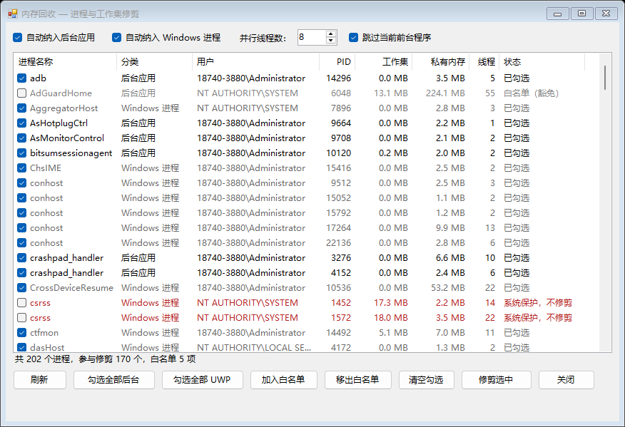

# 内存回收 (MemReclaim)

按指定策略自动回收 Windows 内存中**不需要写回硬盘**的部分：
待机列表、待机列表（无优先级）、系统文件缓存，以及定时合并内存列表。

---

## 一、实测结论

### 1.1 四项清理功能全部可用

在管理员权限下实测（普通会话即可，**无需**计划任务提权）：

| 清理项 | 实测结果 |
|---|---|
| 待机列表 Standby list | **可用**（曾一次回收 904 MB） |
| 待机列表（无优先级） | **可用** |
| 系统文件缓存 System file cache | **可用** |
| 合并内存列表 Combine | **可用**（曾一次合并 82885 页） |

两项所需特权均能正常启用：

```
SeProfileSingleProcessPrivilege → 已启用 (RtlAdjustPrivilege)
SeIncreaseQuotaPrivilege        → 已启用 (RtlAdjustPrivilege)
```

### 1.2 关键：程序文件不能带「低完整性标签」

实测确认，四项清理能否工作，**取决于程序文件的完整性标签**，而非账户权限：

| 文件状态 | 进程完整性级别 | 四项清理 |
|---|---|---|
| 无标签（普通位置） | `High` | **全部成功** |
| 带 Low 标签（沙箱 / 受管目录） | `Low` | **全部失败** |

检查方法（在程序目录执行）：

```powershell
icacls MemReclaim.exe | Select-String "Mandatory Label"
```

出现 `Mandatory Label\Low Mandatory Level` 即为受限，必须按下节处理。

### 1.3 处理办法：必须用【复制】，不能用【移动】

这是最容易踩的坑。NTFS 的规则决定了两种操作结果完全不同：

| 操作 | 机制 | 结果 |
|---|---|---|
| **复制** | 创建新文件，继承目标目录属性 | 标签消失 → **可用** |
| **移动** | 同卷移动＝重命名，ACL 与标签原样保留 | 标签跟着走 → **仍然失败** |

所以：**右键 →「复制」→ 粘贴到普通目录（如 `C:\MemReclaim\`），再以管理员身份运行。**
把文件「移动」或「拖拽」过去是无效的。

程序启动时会自行检测并在必要时给出上述提示，无需手动排查。

> 注：这与杀毒软件无关。若怀疑被安全软件拦截，请以安全软件自身的拦截日志为
> 依据，不要仅凭「特权启用失败」就归因于安全软件——本工具的早期版本犯过这个
> 错误。另外，用 `icacls /setintegritylevel` 强行改标签会被 HIPS 类软件拦截，
> 不要尝试。

---

## 二、使用方法

### 2.1 编译

```powershell
powershell -ExecutionPolicy Bypass -File build.ps1
```

使用 Windows 自带的 .NET Framework 编译器，**不需要安装 .NET SDK**。
产物在 `dist/`：

- `MemReclaim.exe` —— 托盘常驻程序（无控制台窗口），清单 `requireAdministrator`
- `MemReclaimConsole.exe` —— 控制台版，清单 `asInvoker`，用于 `--selftest` / `--once`

两个 exe 由同一份源码编译，差别只在编译期嵌入的清单。

### 2.2 首次使用：先自检

```powershell
dist\MemReclaimConsole.exe --selftest
```

会逐项报告本机 4 个清理项是否可用，并给出失败原因。

### 2.3 启动托盘程序

**双击 `MemReclaim.exe`**，程序会自动请求管理员权限。

程序采用两道提权保障：

1. **嵌入 `requireAdministrator` 清单** —— 由 Windows 在启动时弹 UAC 提权（标准做法）
2. **运行时检测 + 自我重启** —— 清单未生效时兜底

第 2 道并非多余：当系统**关闭 UAC**（`EnableLUA=0`）时，`requireAdministrator`
清单会被 Windows 忽略，进程直接以调用者令牌运行。若调用者恰是非管理员，
就只能靠运行时检测来补救。

UAC 提示出现时，点「是」即可。若希望以后不再提示，可勾选 UAC 对话框中的
「始终信任此发布者」——**这是 Windows 官方的持久化授权机制**，比自建提权通道安全。

托盘菜单：
- **立即清理** —— 立刻执行一次全部已启用项
- **修剪工作集** —— 按当前规则修剪进程工作集（见 3.5），与「立即清理」无关
- **启用自动清理** —— 开关自动策略
- **设置…** —— 修改策略与清理项
- 双击图标同样打开设置

设置窗口底部另有四个操作按钮：

| 按钮 | 作用 |
|---|---|
| **检查权限** | 只报告完整性级别与特权状态，**不执行任何清理** |
| **立即清理** | 执行全部已启用项（含按配置的合并） |
| **合并内存页** | **只做页面合并**，不影响其他项 |
| **修剪工作集** | **只做工作集修剪**，不影响其他项 |

「合并内存页」是独立的手动入口，用途与「立即清理」不同：

- 合并会遍历物理页列表寻找内容相同的页面，开销高于待机列表清理，
  不适合频繁触发，因此单独成键按需执行
- 它**不受「清理项目」中合并复选框的约束**——既然手动点了这个按钮，
  意图就是执行合并，与是否纳入自动策略无关
- 结果会显示在下方日志区，例如「已合并 13169 页，折算 51.4 MB」
- 若显示「没有找到可合并的重复页面」，属正常情况，不是故障

「修剪工作集」同理：它只按规则修剪进程工作集，忽略自动修剪的阈值与冷却，
但仍尊重白名单与系统关键进程保护。详细说明见 3.5。

### 2.4 命令行

```powershell
MemReclaimConsole.exe --once       # 执行一次清理后退出（供计划任务调用）
MemReclaimConsole.exe --selftest   # 环境自检
MemReclaimConsole.exe --help       # 帮助
```

`--once` 会同时把结果写入数据目录下的 `MemReclaim.log`。

> 命令行模式**不会**弹 UAC 提权。这是刻意的：计划任务下弹窗会挂住任务，
> 且自我重启会丢失控制台输出。权限不足时，`--selftest` 会如实报告原因。
> 需要提权请在计划任务中勾选「使用最高权限运行」。

### 2.5 部署到其他机器（给别人用）

直接分发 `dist\` 下的两个 exe 即可，无需安装、无需 .NET SDK
（Win7 及以上自带 .NET Framework 4.x）。

**部署时注意三点：**

**① 目标用户必须在 Administrators 组内。**

这是硬性要求，无法绕过。内存清理需要 `SeProfileSingleProcessPrivilege` 与
`SeIncreaseQuotaPrivilege`，二者的默认分配为：

```
SeProfileSingleProcessPrivilege = Administrators
SeIncreaseQuotaPrivilege        = Administrators, LOCAL SERVICE, NETWORK SERVICE
```

普通用户（Users 组）**不在其中**。微软对前者有明确说明：
*"This right shouldn't be granted to individual users."*

若目标用户不是管理员，则**没有安全的实现方式**——把特权授予 Users 组、
或通过 SYSTEM 服务中转，都会把本机暴露在提权风险下，也是杀软的重点拦截对象。
本程序不做这两件事。

**② 用「复制」，不要用「移动」。**

若程序文件带有「低完整性标签」（来自沙箱或受管目录），进程会被强制以降权
状态运行，四项清理全部失败。同卷移动会让标签跟着文件走，复制则会重新继承
目标目录属性。详见 1.2 / 1.3。

程序启动时会自动检测这种情况并给出提示，无需用户自行排查。

**③ 首次运行会被 Windows 拦一次，之后不会（程序会自动处理）。**

从网络分发（网盘、聊天工具、邮件）得到的 exe 会带上**网络标记**
（Mark-of-the-Web，即 `Zone.Identifier` 备用数据流）。附件管理器据此在双击时弹出：

> 打开文件 - 安全警告
> 无法验证发布者。你确定要运行此软件吗？

**这与代码签名无关**，是 MOTW 造成的。实测同一份 exe：带 MOTW 会弹框，
去掉 MOTW 就不弹，二者二进制完全相同。

程序在启动时会**自动清除自身的 MOTW**，所以用户只需在首次运行时点一次「运行」，
此后双击不再被拦。判定结果显示在「检查权限」的日志里，也会出现在 `--selftest` 输出中。

> **为什么不去买代码签名证书？**
> 对这个问题基本无效。签名只会把对话框里的「未知发布者」换成你的名字、图标从红叉变橙叉，
> **弹框依然出现**。要让签名生效，必须把证书导入每台目标机器的
> 「受信任的发布者」存储——那还不如直接清除 MOTW。
> 签名真正能解决的是 **UAC 提示**（见下），那是另一个问题。

**分发方式建议**：用 7-Zip 打包，让接收方用 7-Zip 解压。
Windows 内置解压**会**传播 MOTW，7-Zip 默认不会。这样接收方连第一次弹框都没有。

若只发单个 exe，接收方也可以手动解除，两种方式等效：

- 右键 exe → 属性 → 勾选「解除锁定」
- `Unblock-File <路径>`

## 三、策略说明

### 3.1 两种触发模式

**阈值模式（默认，推荐）**：可用内存低于设定百分比时清理，另有冷却时间。
可选叠加「待机列表超过 N MB 时清理」。

**固定周期模式**：每 N 秒清理一次，不看内存状况。间隔可设为 `0`（尽可能快执行），
此时实际频率由冷却时间决定，设置界面会直接显示生效间隔。

> 为什么默认用阈值：待机列表本质是系统的**磁盘缓存**。清空它会让后续磁盘读取
> 重新从硬盘加载，短期内系统反而变慢。频繁无脑清空是负优化，因此默认走
> 阈值 + 冷却，只在内存确实紧张时才动手。

### 3.2 冷却时间

两次清理的最小间隔（默认 300 秒，可设为 `0`）。设置为 `0` 时冷却不生效，
清理频率完全由触发模式决定。

> 提示：周期模式中间隔设为 0、冷却设为 0，会让程序在每次采样（1 秒）后都执行
> 清理，即每秒清空一次待机列表。这会导致磁盘缓存持续失效、系统明显变慢，
> 通常不是想要的效果。此处不设下限是尊重你的选择，但请谨慎使用。

### 3.3 合并内存列表的触发方式

合并会遍历物理页列表寻找内容相同的页面去重，**开销高于其他所有清理项**，
因此它的触发条件独立于主清理，提供两种方式，**各有独立开关、可任意组合**：

| 方式 | 默认 | 说明 |
|---|---|---|
| **定时** | 开启，30 分钟 | 每 N 分钟执行一次；N 设 `0` 表示不定时 |
| **阈值** | 关闭 | 内存**占用**超过 X% 时执行 |

两种方式**任一满足即触发**，但都要先通过共用的**冷却时间**（默认 300 秒）。
冷却不可省略：阈值在内存持续高占用时每秒都会成立，没有冷却会导致合并被反复
调用。

两个开关**都关闭**时，合并不参与任何自动触发，仅保留「合并内存页」手动按钮。

> **关于「内存占用」这个指标**：界面上写的是占用率，与主清理的「可用率」互补——
> 占用 85% 等价于可用 15%。分开表述是为了贴合任务管理器的读数习惯。
>
> **关于实际收益**（实测数据，供设定阈值参考）：稳态下每次合并约 100 MB，
> 占 16 GB 内存的 0.65%。它的产出取决于系统当前有多少重复页（如多个进程加载
> 同一 DLL），**无法通过提高频率来增加**。因此默认以定时为主，
> 阈值方式留给内存确实吃紧时按需启用。

### 3.4 开机自动启动

在设置里勾选「开机自动启动」后，程序会在当前用户的**启动文件夹**创建指向自身的快捷方式：

```
%APPDATA%\Microsoft\Windows\Start Menu\Programs\Startup\MemReclaim.exe.lnk
```

在资源管理器地址栏输入 `shell:startup` 即可打开该文件夹，右键快捷方式 →「属性」
能看到它的目标路径。也可以直接在任务管理器的「启动」页管理它。

**为什么用启动文件夹而不是注册表 `Run` 项**：

| | 启动文件夹 | 注册表 Run 项 |
|---|---|---|
| 用户能否自行发现 | 能，资源管理器直接可见 | 需要 `regedit` 才能看到 |
| 能否检查指向 | 能，右键属性即可 | 否，只能看一个字符串 |
| 删除方式 | 直接删除文件 | 需改注册表 |
| 任务管理器管理 | 支持 | 支持 |

**状态判定只有一个依据**：启动文件夹里是否存在**指向当前这个 exe** 的快捷方式。

这一点决定了几个行为，都是刻意的：

- **程序被移动或改名后，勾选会自动取消。** 快捷方式仍指向旧路径，判定为无效，
  界面随之显示未勾选——不会出现「界面说已启用、实际开机不启动」。
- **手动删掉快捷方式后，勾选会自动取消。** 下次启动时程序发现实际状态与配置
  不符，会以实际为准并把结果写回配置文件（`%APPDATA%\MemReclaim\MemReclaim.config.xml`
  里的 `<AutoStart>`），避免配置里长期残留过期的 `true`。
- **取消勾选会删除所有指向本程序的快捷方式**，不只是程序自己创建的那个名字。
  用户自己另建了别的名字的快捷方式也能一并清掉，否则会出现「取消了却还在自启」。
  指向其他程序的快捷方式不会被误删。
- **创建失败时不会假装成功。** 启动文件夹不可写等情况会弹窗说明，并把勾选恢复为
  未选中，而不是写一个实际不生效的 `true`。

程序启动时会顺带清掉旧版本留在 `HKCU\Software\Microsoft\Windows\CurrentVersion\Run`
里的 `MemReclaim` 值。不做这一步的话，从旧版升级上来的机器会两处同时生效、
开机启动两个实例（第二个会被单实例锁拦下并弹出「已在运行」）。

> 该功能**不需要管理员权限**：启动文件夹属于当前用户，普通权限即可写入。

### 3.5 工作集修剪（Working Set Trim）

与上面四项清理**同层级但独立执行**：那四项操作的是系统级内存列表，
这一项操作的是**具体进程的工作集**。

#### 3.5.1 为什么是「工作集修剪」而不是「主动压缩」

这一点有实测依据（详见 [单进程压缩完整报告.md](单进程压缩完整报告.md)，
2026-11-04，Win11 26300 内核 x64），结论可概括为：

| 尝试过的手段 | 结果 |
|---|---|
| per-process 压缩存储（`SmpKeyedStoreCreate`） | 返回成功，但 `SmFirstTimeInit` 门禁关闭，store 建不起来 |
| 主动 Trim（`ZwSetSystemInformation(0x6D/0x15)`） | 返回 `STATUS_SUCCESS`，实际只回收 0.2 MB |
| 页驱逐（`SmFeEvictInitiate` + `MmStoreEvictComplete`） | 返回 `0x400` 并成功，树条目 3→2，**压缩进程 WS 无变化** |
| 唤醒写入器（`MiWakeModifiedPageWriter`） | 成功、无蓝屏，**可用页数前后完全相同，零效果** |
| **`EmptyWorkingSet`（用户态）** | **38 个后台进程回收 1,694.8 MB，压缩进程 WS 590→839 MB** |

根因：Windows 的内存压缩是**被动机制**——只有页面真的需要被换出时才压缩。
驱动能调优先级、唤醒线程、标记驱逐，但**无法制造「页面必须换出」这个需求**。
而 `EmptyWorkingSet` 把工作集页面推入待机/已修改列表，恰好制造了真实换出需求，
于是压缩被真正触发。

所以本程序不试图控制压缩本身，只做那唯一有效的事：修剪工作集。

#### 3.5.2 配置项

设置窗口中的「工作集修剪」分组（与「清理项目」同层级、独立成组）：



| 项 | 默认 | 说明 |
|---|---|---|
| 启用 | 关 | 总开关 |
| 并行线程数 | 4 | 1–32 |
| 内存占用超过 | 85% | 达到该占用率才**自动**修剪；手动修剪不受此限制 |
| 冷却 | 600 秒 | 两次**自动**修剪的最小间隔 |
| 自动纳入后台应用 | 关 | 一键把所有后台应用加入修剪目标 |
| 自动纳入 Windows 进程 | 关 | 同上，范围为 svchost/conhost 等系统组件 |
| 白名单 | 空 | 名单内进程**永不修剪**，优先级高于一键纳入 |
| 跳过当前前台程序 | **开** | 正在被操作的应用即使命中规则也不修剪（见 3.5.9） |

点「进程列表…」打开独立窗口，可以逐进程勾选、管理白名单、对选中项立即修剪：



窗口内各列含义：

| 列 | 说明 |
|---|---|
| 进程名称（带复选框） | 勾选 = 显式纳入修剪目标（按进程名保存） |
| 分类 | 前台应用 / 后台应用 / Windows 进程 |
| 用户 | `DOMAIN\Account`，受保护进程可能为空 |
| PID / 线程 | 当前进程 ID 与线程数 |
| 工作集 | 该进程当前驻留物理内存的字节数 |
| 私有内存 | 私有提交量（对应任务管理器的「提交大小」） |
| 状态 | 白名单豁免 / 系统保护 / 自动纳入 / 已勾选 / 修剪结果 |

顶部的「自动纳入后台应用」「自动纳入 Windows 进程」「跳过当前前台程序」与设置窗口里的同名项是
同一份配置，任一处修改都会立即生效。窗口关闭时自动落盘。

#### 3.5.3 进程分类口径

只分三类，与任务管理器的分组对应：

| 分类 | 判定依据 |
|---|---|
| **前台应用** | 自身有可见顶层窗口，**或**与某个有窗口的进程共用同一映像路径 |
| **后台应用** | 其余无窗口进程（不含 Windows 目录下的组件） |
| **Windows 进程** | 路径在 `%SystemRoot%` 下，**排除** `DriverStore`（第三方驱动包） |

实测分布（本机同一时刻，202 个进程）：

| 分类 | 数量 | 任务管理器对照 |
|---|---|---|
| 前台应用 | 19 个进程 / **6 个应用组** | 应用 **(6)** |
| 后台应用 | 69 | 后台进程 (79) |
| Windows 进程 | 112 | Windows 进程（截图中未展开） |

> **「前台应用」为什么要按映像路径归组**
>
> QQ 有 8 个进程（`QQNT\QQ.exe`），只有 1 个持有窗口。任务管理器把它们合并
> 显示为「QQ (8)」，整组算作应用。若只按「进程自己有没有窗口」判定，另外 7 个
> 会被误判成后台应用，进而被「自动纳入后台应用」扫进修剪目标——修剪正在使用的
> QQ 的辅助进程，会直接造成卡顿。DeepSeek Harness（6 个进程）同理。
>
> 反例：`HYPHelper.exe` 有 5 个进程但全部无窗口，`steamwebhelper.exe` 有 8 个
> 也全部无窗口，它们仍算后台应用——归组只对「组内存在窗口进程」的路径生效。

> **「Windows 进程」为什么要单独分出**
>
> `svchost`（20+ 个）、`conhost`、`RuntimeBroker`、各类驱动服务都在 Windows
> 目录下。若不区分，它们会被算作「后台应用」，用户点一次「自动纳入后台应用」
> 就会把全部系统组件纳入修剪，导致整机卡顿。
> `DriverStore` 里的第三方驱动服务（Intel / NVIDIA / Realtek）仍算后台应用。
>
> 取不到路径的进程（多为受保护的系统进程）按「Windows 进程」处理——
> 宁可保守，也不要因为查询失败就把它当第三方程序去修剪。

**两个不参与分类的独立属性**：

| 属性 | 用途 |
|---|---|
| **系统保护** | `csrss`、`services`、`Memory Compression`、`MsMpEng` 等。**禁止修剪、禁止勾选**，与分类无关 |
| **UWP** | 有包标识的 Store 应用。仅作识别用，不参与分类；界面上按有无窗口归入前台/后台 |

> 口径说明：这里的「后台应用」采用任务管理器式判定。它不是 Windows
> 「设置 → 后台应用」里的那个开关，后者只针对 UWP 的 PLM 机制。
> 两者名称相同但含义不同，本程序用的是前者。

> 分类口径调整过两次（早期把 Windows 组件算作后台应用、且未做多进程应用归组）。
> 旧配置里按旧口径批量勾选进来的名字会残留在勾选列表中，继续把 `svchost` 之类
> 纳入修剪。进程列表里提供了「清空勾选」按钮用于一键重置。

#### 3.5.4 优先级

```
系统保护（不可修剪）
  > 白名单（豁免）
    > 当前前台程序（运行时跳过）
      > 一键纳入
        > 显式勾选
```

白名单**压过**一键纳入——否则「豁免」就没有意义。

「一键纳入后台应用」只作用于**后台应用**这一类，不含前台应用与 Windows 进程：
前台应用是用户正在使用的程序，修剪会让它立刻缺页；Windows 进程是系统组件，
修剪会造成连锁缺页。两者只能由用户显式勾选后才参与。

勾选状态**按进程名保存**（不带 `.exe`，大小写不敏感），不是按 PID：
PID 每次开机都变，存 PID 等于勾选只对本次会话有效。代价是同名的多个实例
（如多个 `chrome.exe`）会一起被选中，对内存修剪而言这正是想要的效果。

#### 3.5.5 并发模型

修剪是逐进程的独立操作，进程间无共享状态，可以安全并行。实现用**固定数量的
工作线程从队列领取任务**，而不是每个进程开一个线程：

- 线程太少：进程多时线性耗时（200 个进程单线程约 4 秒）
- 线程太多：`EmptyWorkingSet` 会争用内存管理器锁，过度并发互相阻塞，还会抢 CPU

实测（本机 198–203 个进程，12 个目标）：

| 线程数 | 耗时 | 回收量 |
|---|---|---|
| 1 | 11 ms | 24.9 MB |
| 4 | 6 ms | 24.9 MB |
| 8 | 3 ms | 24.9 MB |
| 16 | 2 ms | 24.8 MB |

回收量在各线程数下保持一致，说明并发没有漏处理，只是缩短了墙钟时间。

#### 3.5.6 严格异步

三处保证：

1. **`TrimNowAsync` 立即返回**（实测调用耗时 1 ms），全部工作在后台线程池完成；
2. **自动触发只在定时器里做判断**，执行交给独立线程，不拖长 tick；
3. **修剪不占用主清理的锁**——两者操作对象不同（系统内存列表 vs 进程工作集），
   并发不会互相破坏。若共用一把锁，修剪进行时用户点「立即清理」会被无故拒绝。

界面的进度与结果通过 `Trimmed` / `TrimProgress` 事件回报，订阅方自行切回 UI 线程。

#### 3.5.7 实测效果

本机（16 GB，203 个进程）启用「自动纳入后台应用」后：

```
工作集修剪：171/174 个进程成功，释放约 3.21 GB，耗时 255 ms
```

> 「释放」指的是本次把多少物理页推出了工作集。进程随后会按需重新调入，
> 所以这是**回收量**而非永久节省量。频繁修剪会让进程反复缺页，净收益为负——
> 这正是默认门槛 85%、冷却 600 秒的原因。

#### 3.5.8 系统关键进程为什么不修剪

`EmptyWorkingSet` 对 `csrss`、`services`、`Memory Compression` 这类进程本身是
允许的（有管理员权限即可），但把它们的代码页推出物理内存会立刻造成连锁缺页，
表现为整机卡顿。误伤代价远高于少修剪几个无害进程，因此按名称硬编码屏蔽。

白名单机制在此基础上再给用户一层控制。

#### 3.5.9 前台保护：正在用的程序不修剪

这是独立于分类的一层保护，解决一个具体问题：
**后台应用被勾选后，用户又把它切到前台使用，此时不该再修剪它。**

实现分两处，缺一不可：

| 位置 | 行为 |
|---|---|
| **运行时** | `SelectTargets` 跳过「当前拥有输入焦点」的进程（同映像路径一并跳过）。这是硬保护——即使被显式勾选、或落在「自动纳入」范围内，也一律跳过 |
| **焦点事件** | 用 `SetWinEventHook(EVENT_SYSTEM_FOREGROUND)` 监听焦点切换，事件驱动、**实测 0–2 ms 响应**；切换瞬间即重算焦点标记并**自动取消勾选** |
| **周期同步** | **每 1.5 秒**重算一次窗口状态与分类，并刷新工作集/私有内存数值；只更新真正变化的单元格，不重建列表 |
| **兜底轮询** | 5 秒一次焦点 PID 比较（钩子安装失败时降到 300 ms） |

四层各司其职：

- **运行时跳过**保证「不会真的修剪正在用的程序」；
- **焦点事件**保证「切换窗口后界面立刻反应」；
- **周期同步**保证「窗口出现/消失导致的分类变化、以及内存数值」能持续反映——这两项不会产生焦点事件，只能靠定时重算；
- **兜底轮询**防止钩子漏事件后状态永久错位。

> 早期版本只有 1 秒轮询，且分类列是枚举时的快照，所以列表看起来是静态的：
> 打开/关闭别的程序窗口后分类不变，内存数值也不动。现在焦点用事件钩子、
> 其余用 1.5 秒增量同步解决。

> **「当前焦点」与「前台应用」分类不是一回事**
>
> - 分类里的「前台应用」看的是**有没有可见窗口**（任务管理器口径），
>   包含被遮挡、最小化的窗口；
> - 前台保护看的是**真正的输入焦点**，只有用户此刻正在操作的那一个。
>
> 因此一个最小化的程序仍算「前台应用」分类，但不影响它被纳入修剪。
> 修剪一个最小化的程序是合理的——它只是暂时不显示，用户切回来时才需要快速响应。

同映像路径一并跳过是必要的：QQ 有 8 个进程，只跳过持有焦点窗口的那 1 个，
另外 7 个照样被修剪，起不到保护作用。

开关「跳过当前前台程序」在进程列表窗口顶部，**默认开启**。关掉它意味着
正在打字的程序也可能被修剪，会明显卡顿，一般不要关。

### 3.6 通知行为

**默认不发送任何通知。** 清理在后台静默完成，不弹气泡、不打扰使用。

唯一的例外：**清理失败时仍会提示**。

这是刻意的设计——如果失败也一并静默，会出现「程序看起来在工作、实际每次都失败」
的情况，用户无从察觉。成功静默、失败告知，既安静又不会漏掉问题。

若想连成功也看到提示，可在设置里勾选「清理成功后显示气泡通知」。

> 另：「权限不足」这类启动期异常始终会弹窗说明，不受此开关影响。
> 这类问题若不提示，用户只会看到清理无效却找不到原因。

### 3.7 关于「不会写回硬盘」的那些项

按你的说明，以下项在回收时不产生磁盘写入，本工具实现的就是它们：

| 项 | 是否实现 | 需要的特权 |
|---|---|---|
| Standby list | 是 | SeProfileSingleProcess |
| Standby list (without priority) | 是 | SeProfileSingleProcess |
| System file cache | 是 | SeIncreaseQuota |
| Combine memory lists | 是 | SeProfileSingleProcess |
| Working set（按进程修剪） | **是**（3.5） | 不需要额外特权 |

关于 Working set：早期版本未实现，当时的理由是
`MemoryEmptyWorkingSets`（`SystemMemoryListInformation` 的命令 2）会把**所有**进程
的工作集整体清空、且包含脏页，无法只清「干净」部分。

3.5 的工作集修剪用的是**另一个接口**：`psapi!EmptyWorkingSet`，逐个进程调用、
由用户选择目标、把系统关键进程与白名单排除在外。它同样只把页面推入待机/已修改
列表（干净页可丢弃、脏页由系统按需写回），不做任何强制写盘，因此与上面的原则一致。
两者的区别是**粒度**：前者无法选择目标，后者可以。

---

## 四、实现依据

所有 API 用法均经源码级核实，非凭记忆编写：

| 项 | 信息类 | 结构体 | 证据 |
|---|---|---|---|
| 待机列表 | `SystemMemoryListInformation` 0x50 | `SYSTEM_MEMORY_LIST_COMMAND` = 4 | Mem Reduct `main.c` |
| 待机列表（无优先级） | 同上 | = 5 (`MemoryPurgeLowPriorityStandbyList`) | 同上 |
| 系统文件缓存 | **`SystemFileCacheInformationEx` 0x51** | `SYSTEM_FILECACHE_INFORMATION` | 同上 |
| 合并内存列表 | `SystemCombinePhysicalMemoryInformation` 0x82 | `MEMORY_COMBINE_INFORMATION_EX`（24 字节，全零） | 同上 |
| 工作集修剪 | —（不需要 `NtSetSystemInformation`） | — | `psapi!EmptyWorkingSet`，实测有效 |

两个易错点（已避开）：

1. **文件缓存用的是 0x51 而非 0x15**。Mem Reduct 的日志字符串写的是
   `SystemFileCacheInformation`，但真实调用的信息类是 `SystemFileCacheInformationEx`。
2. `SYSTEM_MEMORY_LIST_INFORMATION` 含两个 `SIZE_T[8]` 内联数组（x64 共 176 字节），
   用 `Marshal.PtrToStructure` 解析会错位。本工具改用固定偏移逐字段读取，
   并已用性能计数器交叉验证。

来源：
- [Geoff Chappell — SYSTEM_INFORMATION_CLASS](https://www.geoffchappell.com/studies/windows/km/ntoskrnl/inc/api/ntexapi/system_information_class.htm)
- [Geoff Chappell — ZwSetSystemInformation](https://www.geoffchappell.com/studies/windows/km/ntoskrnl/api/ex/sysinfo/set.htm)
- [Mem Reduct 源码](https://github.com/henrypp/memreduct/blob/master/src/main.c)

---

## 五、文件结构

```
内存回收/
├─ build.ps1                 编译脚本（产出两个 exe）
├─ src/
│  ├─ Native.cs              P/Invoke、结构体偏移、特权启用
│  ├─ MemoryState.cs         内存状态读取（固定偏移解析）
│  ├─ MemoryCleaner.cs       4 项清理实现
│  ├─ ProcessInfo.cs         进程枚举与分类（前台/后台/UWP/系统关键）
│  ├─ WorkingSetTrimmer.cs   工作集修剪（多线程并行、目标选择）
│  ├─ ProcessListForm.cs     进程列表界面（勾选、白名单、手动修剪）
│  ├─ TriggerEngine.cs       触发引擎（阈值/周期 + 冷却 + 异步修剪）
│  ├─ Storage.cs             数据目录（%APPDATA%，含旧配置迁移）
│  ├─ Config.cs              配置与持久化
│  ├─ TrayApp.cs             托盘程序
│  ├─ SettingsForm.cs        设置界面
│  ├─ SelfTest.cs            自检
│  ├─ ConsoleOut.cs          安全控制台输出（winexe 无控制台时不崩溃）
│  ├─ MotwHelper.cs          网络标记（MOTW）检测与清除
│  ├─ AutoStart.cs           开机自启（启动文件夹快捷方式）
│  ├─ IntegrityCheck.cs      完整性级别检测与建议
│  ├─ ElevationHelper.cs     提权处理
│  └─ Program.cs             入口与命令行
├─ dist/                     编译产物
│  ├─ MemReclaim.exe         主程序（requireAdministrator）
│  └─ MemReclaimConsole.exe  控制台版（asInvoker）
└─ temp/                     诊断工具与实测记录
```

配置文件：`%APPDATA%\MemReclaim\MemReclaim.config.xml`（可直接编辑）
日志文件：同目录下的 `MemReclaim.log`、`MemReclaim.selftest.txt`

清单文件：`src/app.manifest`（主程序）、`src/app-console.manifest`（控制台版）。
两者差异仅在 `requestedExecutionLevel`。

---

## 六、风险提示

1. **清空待机列表会丢弃磁盘缓存**。清理后首次读取大文件会明显变慢。
   这是正常现象，不是故障。这也是默认采用阈值模式的原因。

2. **执行清理需要管理员权限**。缺权限时程序会在托盘提示，并在设置窗口显示警告；
   自检可查看具体哪一项失败。
   注意区分：**只有清理需要提权**，开机自启（3.4）写的是当前用户的启动文件夹，
   普通权限即可。

3. **合并内存列表开销较高**。默认 30 分钟一次。若你观察到周期性卡顿，
   把周期调长或关闭该项。

4. **程序文件不能带「低完整性标签」**（详见 1.2 / 1.3）。必须用**复制**的方式
   把程序放到普通目录，用**移动**的方式无效。程序启动时会自动检测并提示。

5. **从网络分发得到的文件首次运行会被 Windows 拦一次**（MOTW，详见 2.5）。
   程序会自动清除自身标记，第二次起不再拦截。

6. **内存压缩本身不能主动触发**。内存压缩（任务管理器里的「内存压缩」）是被动机制，
   只有页面真的需要换出时才启动；驱动层的各种「主动压缩」手段实测全部零效果
   （详见 3.5.1）。本程序的做法是制造真实的换出需求，即修剪工作集。
   注意 `EmptyWorkingSet` 的效果约 6 秒达峰、100 秒内消散，因此定时高频修剪
   净收益接近于零。

7. **工作集修剪会让进程短暂变慢**。被修剪的进程下次访问自己刚用过的内存时
   需要重新缺页调入。这正是默认门槛 85%、冷却 600 秒的原因，也是默认不启用
   的原因。若要启用，建议配合白名单排除常用的大型程序（IDE、浏览器、游戏）。

8. **本工具不会写回脏页**。所实现的操作只回收「干净」页面，
   不会触发磁盘写入，也不会丢失数据。
